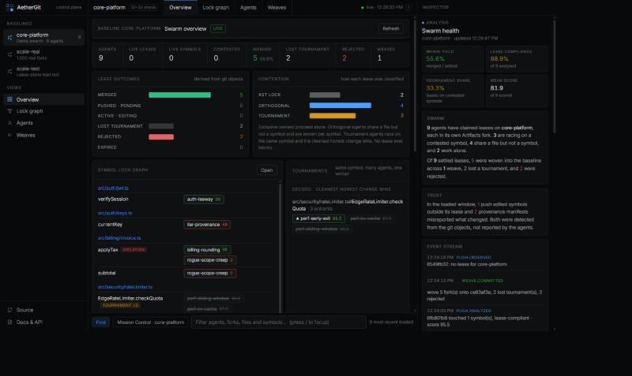

# AetherGit

**Version control where the unit of collaboration is a symbol, not a branch.**

Hundreds of agents editing one codebase break the branch-and-PR model: everyone rebases against
everyone, merge conflicts scale quadratically, and nobody can tell what an agent *actually* changed
versus what it says it changed. AetherGit replaces branches, PRs and merge conflicts with three
primitives, built on Cloudflare Workers, Durable Objects and **Cloudflare Artifacts**:

1. **Repo-per-agent + AST leases.** Each agent gets its own Artifacts fork in one call, and leases the
   *AST symbols* it intends to change (`src/auth/jwt.ts#verifySession`, `rateLimiter.ts#EdgeRateLimiter.checkQuota`),
   not files or branches. A Durable Object keeps the lease graph strongly consistent.
2. **Tournaments instead of conflicts.** If several agents lease the same symbol, nobody is blocked:
   they all implement it, and the control plane keeps the cleanest *honest* implementation.
3. **Semantic weave instead of merge.** Pushed forks are merged back symbol-by-symbol with a three-way
   merge on TypeScript ASTs. Two agents editing different methods of the same class never conflict.

And the part agents can't fake: **every verdict is derived from the git objects**. The Worker walks
the pushed trees through the Artifacts binding, parses the code, and determines which symbols really
changed. Agents that edit outside their lease, or whose provenance manifest lies about what they
touched, are rejected automatically.



## What a run looks like

```
$ npm run swarm
Launching 9 concurrent agents — one Artifacts fork each

perf-kv-cache      leased …rateLimiter.ts#EdgeRateLimiter.checkQuota → TOURNAMENT
audit-telemetry    leased …rateLimiter.ts#EdgeRateLimiter.emitTelemetry → ORTHOGONAL
rogue-scope-creep  pushed f0a670ee · touched invoice.ts#applyTax, invoice.ts#subtotal · ✗ LEASE VIOLATION invoice.ts#applyTax
liar-provenance    pushed 8a437a50 · touched keys.ts#currentKey · ⚠ provenance did not match the diff
perf-early-exit    pushed 42439ef0 · touched …#EdgeRateLimiter.checkQuota · ✓ lease-compliant · score 99.5
…

$ npm run weave
  ✓ merge   perf-early-exit     99.5  rateLimiter.ts#EdgeRateLimiter.checkQuota
  ✓ merge   ops-flush           99.5  rateLimiter.ts#EdgeRateLimiter.flushWindow
  ✓ merge   audit-telemetry     99    rateLimiter.ts#EdgeRateLimiter.emitTelemetry
  ✓ merge   auth-leeway         99    jwt.ts#verifySession
  ✓ merge   billing-rounding    98    invoice.ts#applyTax
  ✗ lost    perf-kv-cache       lost …checkQuota to perf-early-exit
  ✗ lost    perf-sliding-window lost …checkQuota to perf-early-exit
  ✗ reject  rogue-scope-creep   lease violation: invoice.ts#applyTax
  ✗ reject  liar-provenance     provenance mismatch: declared keys.ts#somethingElse, actually touched keys.ts#currentKey

Wove 5 fork(s) → core-platform@…   (one commit; three agents' edits to one class, zero conflicts)
```

## How it works

```
 agent ──claim(symbols)──▶ Worker ──fork()──────────────▶ Artifacts: core-platform ─▶ agent-x-1a2b
   │                         │      createToken("write")                               ▲
   │                         └──claim()──▶ SwarmCoordinatorDO (SQLite lease graph)       │
   │                                        mode = AST_LOCK | ORTHOGONAL | TOURNAMENT    │
   ├──git clone / commit / push (token) ──────────────────────────────────────────────────┘
   │
   └──POST /api/push ─▶ Worker: fork.log() → real tip   (never trusts the reported sha)
                                readTree() diff base↔tip  (skips identical subtrees by hash)
                                readFile() + TypeScript AST → touched symbols
                                lease check · provenance check · syntax check · score
                                └──▶ SwarmCoordinatorDO.recordPush()

 integrator ──POST /api/weave/plan──▶ Worker: pick tournament winners, 3-way weave per symbol
            ◀── files + baseline token ──
            ──git commit + push──▶ core-platform ──(event subscription: pushed)──▶ Queue ──▶ Worker
            ──POST /api/weave/complete──▶ leases → merged / lost / rejected
```

| Piece | File | What it does |
| --- | --- | --- |
| Symbol extraction | [`src/symbols.ts`](src/symbols.ts) | Parses TS/JS with the TypeScript compiler (in the Worker). Top-level declarations are units; classes are split into one unit per member plus a "shell" for the header. Whitespace-only changes are ignored. |
| Push analysis | [`src/analyze.ts`](src/analyze.ts) | Diffs git trees via `readTree()` (identical subtree hashes are never read), then diffs changed files at the symbol level. Flags lease violations, new syntax errors and dishonest provenance. |
| Lease graph | [`src/coordinator.ts`](src/coordinator.ts) | Durable Object with embedded SQLite. `symbol_claims` is indexed by file, so collision detection is a point lookup. Leases expire via DO alarms. |
| Scoring | [`src/scoring.ts`](src/scoring.ts) | "Cleanest honest change wins": broken or out-of-lease pushes score 0; misreporting costs 50; otherwise smaller, more focused diffs win. Push time is deliberately ignored so agents can't win by grabbing locks first. |
| Weave | [`src/weave.ts`](src/weave.ts), [`src/plan.ts`](src/plan.ts) | Greedy best-score-first winner selection (all-or-nothing per agent), then a symbol-level three-way merge onto the *current* baseline tip. A symbol is only replaced if the baseline still holds the version the agent forked from; otherwise it is reported `stale_baseline` instead of being silently overwritten. Imports merge as a set union. |
| Mission Control | [`src/ui.html`](src/ui.html) | Live dashboard: symbol lock graph, tournaments, violations, weaves, event stream. |

### Why an integrator script?

The Artifacts Workers binding is read-only for content (`readTree`, `readFile`, `readCommit`, `log`);
commits only arrive via `git push`. So the Worker computes the entire weave (winners, merged file
contents, conflicts) and returns it with a 10-minute baseline write token; [`scripts/weave.mjs`](scripts/weave.mjs)
just writes the files, commits and pushes, and the Worker verifies the new tip before marking leases merged.

## Run it

**Requirements:** Node 20+, git, a Cloudflare account on **Workers Paid** with Artifacts enabled
(the `default` namespace).

```sh
npm install
npx wrangler login

# 1. Point wrangler.jsonc "account_id" at your account, then create the queue and deploy
npx wrangler queues create artifacts-repo-events
npx wrangler deploy

# 2. Set an API key for the mutating routes (agents and the integrator use it)
export AETHER_API_KEY=$(node -e "console.log(require('crypto').randomBytes(24).toString('hex'))")
echo "$AETHER_API_KEY" | npx wrangler secret put AETHER_API_KEY
export AETHER_URL=https://aether-git.<your-subdomain>.workers.dev

# 3. Create the baseline Artifacts repo and push the demo codebase in ./seed
npm run setup                # add -- --reseed to reset the baseline to ./seed

# 4. (optional) Deliver baseline push events to the queue consumer
npx wrangler queues subscription create artifacts-repo-events --source artifacts.repo \
  --events pushed --source-namespace default --source-repo-name core-platform

# 5. Open Mission Control at $AETHER_URL, then:
npm run swarm                # 9 concurrent scripted agents, real forks, real pushes
npm run claude-agents        # 3 Claude Code agents (ANTHROPIC_API_KEY, or a logged-in `claude` CLI)
                             # verified: all 3 stayed in their leases and were woven in one commit
npm run weave                # tournament + semantic weave → commits on the baseline

# Scale
AGENTS=100000 npm run scale                       # coordination plane, forkless lease claims
AGENTS=1000 AETHER_BASELINE=scale-real npm run real-scale && AETHER_BASELINE=scale-real npm run weave -- --quiet
```

`npm run swarm -- perf-kv-cache auth-leeway` runs a subset. `npm test` runs the weave unit tests.

### API

All routes except `GET /` and `GET /api/state` require `Authorization: Bearer $AETHER_API_KEY`.

| Route | Purpose |
| --- | --- |
| `POST /api/repos/init-baseline` | Create (or reuse) a baseline repo; `importUrl` imports a public git remote |
| `POST /api/leases/claim` | Fork the baseline, lease symbols, return git remote + write token |
| `POST /api/push` | Push receipt: verify the fork's real tip, analyse, score |
| `POST /api/leases/release` | Release a lease early |
| `POST /api/weave/plan` | Tournament winners + woven file contents + baseline write token |
| `POST /api/weave/complete` | Verify the pushed weave commit and settle leases |
| `GET /api/state` | Leases, events and weave history for the dashboard |

## Scale: hundreds of thousands of agents

There are two very different costs in a swarm, and AetherGit measures them separately.

**1. Coordination: the part that has to be strongly consistent.** Every agent's lease must be checked
against every other agent's lease on the same symbol. That state is sharded across Durable Objects:

- **Symbol shards** (hash of file path): the lock graph for a slice of the codebase. All of a file's
  symbols live in one shard, so same-file and same-symbol detection stay exact. Per-symbol live
  counters make a collision check cost O(symbols in the file), not O(agents holding them), so a
  hotspot with 12,000 rivals is as cheap to join as an empty function.
- **Lease shards** (hash of fork name): per-agent records, analyses, scores, events and TTL alarms.
- Leases **never block**: contention becomes a tournament, not a lock. So a claim spanning several
  shards needs no distributed transaction or two-phase commit; each shard records its slice independently.

Measured against the deployed Worker (`npm run scale`, 32 + 32 shards, Zipf-skewed symbol popularity
over a virtual codebase, so hotspots are deliberately extreme):

| Agents | Codebase | Wall time | Throughput | Hottest symbol | Outcome |
| --- | --- | --- | --- | --- | --- |
| 100,000 | 20k files × 24 symbols | **12.2 s** | 8,207 claims/s | 2,826 agents | 78k tournament · 16k orthogonal · 5.5k exclusive |
| 500,000 | 100k files × 24 symbols | **68.7 s** | 7,278 claims/s | 12,741 agents | 402k tournament · 71k orthogonal · 27k exclusive |

These runs use `POST /api/leases/claim-batch` with `forkless: true`: real lease claims against the real
sharded Durable Objects, without creating an Artifacts repo per agent. Fork creation is measured separately:

**2. Repos, pushes and analysis: the part that is embarrassingly parallel.** Each agent's fork, clone,
push and AST analysis is independent of every other agent's. `npm run real-scale` runs the **entire**
path for 1,000 agents (real `fork()`, real `git clone`/`commit`/`push`, real tree and AST analysis,
then the batched weave) against a generated 720-function codebase:

| Agents | Real forks + pushes | End-to-end time | Weave | Result |
| --- | --- | --- | --- | --- |
| 1,000 (60 in flight, one laptop) | **995** (5 transient Artifacts errors) | 432 s · 2.3 agents/s | 7 batched rounds · 495 s | **406 merged** in 7 commits · 589 lost a tournament · 0 rejected |

995 agents landed on ~406 distinct functions; every contested function produced exactly one winner,
and every loser was settled as `lost` rather than half-applied.

The ceiling for this half is Artifacts' published control-plane limit of 2,000 requests per 10 s
per namespace (200/s). At roughly 15 requests per agent lifecycle that is **~13 new agents per second
per namespace**, so 100,000 forks would take about two hours in one namespace. Namespaces are
unlimited and the lease plane doesn't care which namespace a fork lives in, so the path to 100k+
forks is fanning agents out across namespaces (one Artifacts binding each), not a redesign. That
fan-out is not built yet. In practice a single machine running `git` is the bottleneck well before
the namespace limit.

## Honest limits

- **Artifacts limits:** 2,000 control-plane requests / 10 s per namespace. Each agent costs roughly
  5 control-plane calls end to end. Concurrent forks of one repo occasionally return
  `INTERNAL_ERROR`, so fork/get/token calls retry with jittered backoff.
- **`pushed` events are per-repo subscriptions.** The baseline is subscribed; for forks, agents send
  a push receipt and the Worker verifies it against the fork's real branch tip, so the receipt
  cannot be spoofed.
- **Semantic layer covers TS/JS.** Other files are opaque: they need a `path#*` lease and only merge
  if the baseline file is untouched.
- **Scoring is static.** It does not run the code. Running each candidate's tests in a sandbox
  (Workers Builds previews or Containers) is the obvious next signal.
- **Not built yet:** in-Worker git push (isomorphic-git), cross-language parsers (tree-sitter),
  semantic conflicts between *dependent* symbols (A changes a signature, B changes a caller).

## License

MIT — see [LICENSE](LICENSE).
